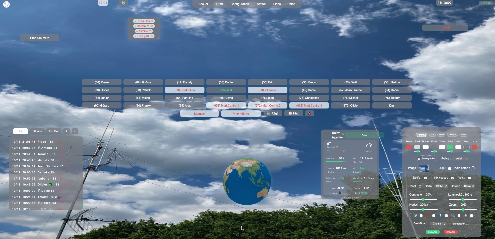
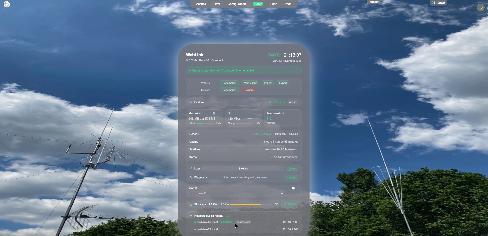
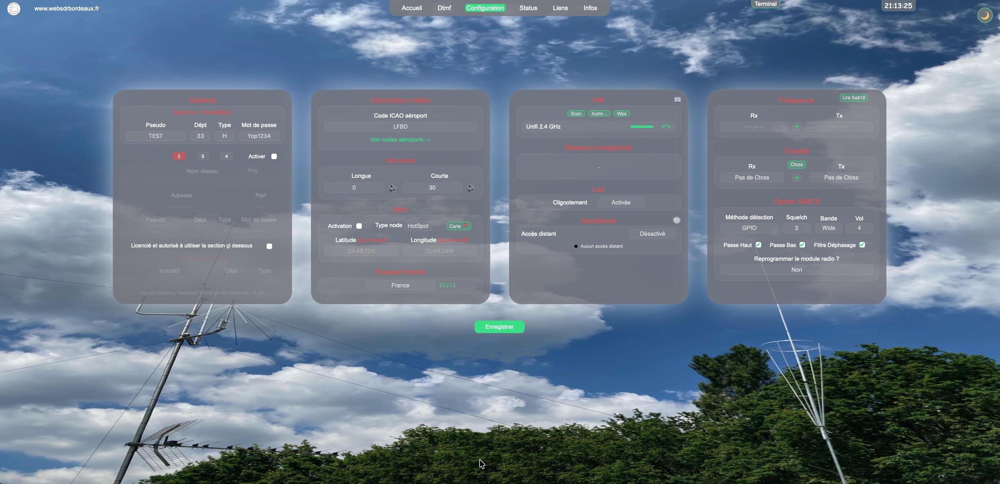

  

<h1 align="center">WebLink</h1>

  <b>La distribution clé en main pour hotspots SvxLink sur Orange Pi Zero</b> 
  Pmr446 · Radioamateurs · Interface web complète · Mises à jour sans refaire de carte

  
  
  
  
  

  <a href="https://www.websdrbordeaux.fr"><b>Télécharger l'image</b></a> ·
  <a href="https://github.com/Fredo-33/WebLink/releases"><b>Versions</b></a> ·
  <a href="CHANGELOG.md"><b>Nouveautés</b></a> ·
  <a href="https://github.com/Fredo-33/WebLink/issues/new/choose"><b>Signaler un problème</b></a>

---

**WebLink** est une distribution complète et prête à l'emploi pour hotspots SvxLink sur **Orange Pi Zero**, basée sur Armbian.

On grave la carte, on branche, et tout se règle depuis une interface web claire, sur ordinateur comme sur téléphone, à l'adresse **http://weblink.local**. Aucune ligne de commande n'est nécessaire.

WebLink s'adresse à tout le monde : amateurs de radio en **Pmr446**, sans licence, comme **radioamateurs licenciés**, sur n'importe quel réseau SvxLink.

## En un coup d'œil

| | |
|---|---|
| 🔌 **Prêt en quelques minutes** | on grave, on branche en Rj45, on ouvre http://weblink.local |
| 🎛️ **Tout depuis le navigateur** | réseaux, module radio, Wifi, annonces : zéro ligne de commande |
| 🔄 **Mises à jour en un clic** | interface et système, sans jamais regraver la carte |
| 📡 **Pmr446 et radioamateurs** | indicatif, annonces et Aprs pour les licenciés |
| 🩺 **Diagnostic complet** | qualité de la liaison, activité du réseau, journaux, alerte de place |
| 🛟 **Assistance à distance** | uniquement à votre demande, et vous le coupez quand vous voulez |
| 🎨 **Interface personnalisable** | thèmes, blocs déplaçables, animations, version mobile |

## Aperçu

  
  
  

---

## Sommaire

- [Installation](#installation)
- [Sans câble réseau : le point d'accès Wifi](#sans-câble-réseau--le-point-daccès-wifi)
- [La page d'accueil](#la-page-daccueil)
- [Personnalisation de l'interface](#personnalisation-de-linterface)
- [Réseaux et réflecteurs](#réseaux-et-réflecteurs)
- [Radioamateurs licenciés](#radioamateurs-licenciés)
- [Module radio Sa818](#module-radio-sa818)
- [Connexion Wifi](#connexion-wifi)
- [Assistance à distance](#assistance-à-distance)
- [Page Status : surveillance et diagnostic](#page-status--surveillance-et-diagnostic)
- [Mises à jour sans refaire de carte](#mises-à-jour-sans-refaire-de-carte)
- [Commandes Dtmf](#commandes-dtmf)
- [Version mobile](#version-mobile)
- [Signaler un problème, proposer une idée](#signaler-un-problème-proposer-une-idée)
- [Contenu du dépôt](#contenu-du-dépôt)
- [Origine, crédits et licence](#origine-crédits-et-licence)
- [Contact](#contact)

---

## Installation

1. Téléchargez la dernière image (.zip ou .img.xz) sur **https://www.websdrbordeaux.fr**
2. Gravez-la sur une carte micro Sd, par exemple avec Balena Etcher
3. Insérez la carte dans l'Orange Pi Zero, branchez-le sur votre box en **Rj45** (câble réseau) et alimentez-le
4. Ouvrez l'interface depuis un appareil connecté à la même box : **http://weblink.local**

L'image est volontairement la plus légère possible. Elle n'occupe pas toute la carte au départ : un bouton **Étendre** l'agrandit à toute la carte d'un clic, et une mise à jour le fait d'elle-même si la place vient à manquer.

## Sans câble réseau : le point d'accès Wifi

Le hotspot se branche normalement en **Rj45** sur votre box. Si ce n'est pas possible, il crée son propre réseau Wifi pour que vous puissiez quand même le configurer :

- Nom du réseau : **WebLink**
- Mot de passe : **weblink1234**

Connectez-y votre téléphone ou votre ordinateur, ouvrez l'interface, puis connectez le hotspot au Wifi de votre box (par mot de passe ou par le bouton Wps). Une fois le hotspot connecté, le point d'accès s'éteint tout seul.

Si le hotspot perd plus tard son Wifi, le point d'accès revient automatiquement : il reste toujours joignable, même après un changement de box.

## La page d'accueil

Le tableau de bord du réseau, en direct :

- les **salons** du réseau (Pmr 446 MHz, Perroquet, Bac à Sable, Technique, Bavardage, Ri49, Girondin…) et le passage de l'un à l'autre en un clic
- la **liste des nodes connectés**, avec qui parle en ce moment, triable par département ou par prénom, et une fiche pour chaque node
- l'**historique** des derniers passages
- la **carte** et le **globe** des nodes et des relais
- l'**horloge**, la **météo** locale et le **saint du jour**
- la **liste Mumble** des personnes connectées
- un accès direct au site **www.websdrbordeaux.fr**

## Personnalisation de l'interface

La page d'accueil se règle entièrement à votre goût, et vos réglages sont conservés :

- **thèmes de couleurs** au choix, avec la couleur de fond de chaque bloc (relais, nodes, transmissions, historique, horloge…)
- **blocs déplaçables et redimensionnables** : chaque élément se place où vous voulez, à la taille voulue
- **animations de fond** : neige, pluie, feuilles, lucioles, bulles
- un bouton pour **tout remettre à zéro**

## Réseaux et réflecteurs

- un réseau principal par défaut, plus **trois réseaux supplémentaires** à ajouter soi-même depuis l'interface (nom, adresse, port, mot de passe)
- des réseaux radioamateurs déjà intégrés : **Rrf**, **Ri49**, **Girondin**…
- pseudo ou indicatif, département et type de node (hotspot ou relais) réglables
- **annonces vocales** longue et courte, avec la **météo** de l'aéroport de votre choix
- **localisation Aprs**, avec choix de la position directement sur une carte
- fuseau horaire réglable

## Radioamateurs licenciés

Une section dédiée s'active pour les licenciés :

- le hotspot s'identifie avec **votre indicatif** sur les réseaux radioamateurs
- annonce courte toutes les 15 minutes sur ces réseaux (30 minutes ailleurs)
- localisation Aprs possible

## Module radio Sa818

Le module radio se règle entièrement depuis l'interface, sans outil externe :

- fréquences d'émission et de réception (copie de l'une vers l'autre en un clic)
- **Ctcss / Dcs**, squelch, volume, bande **Narrow / Wide**
- filtres passe-haut, passe-bas et déphasage
- méthode de détection du squelch (Gpio ou Siglev)
- **lecture des réglages déjà programmés** dans le module
- **Led** d'activité, clignotement activable

## Connexion Wifi

Pour un hotspot qui ne peut pas être branché en Rj45 :

- **scan** des réseaux disponibles, avec le niveau de signal
- connexion par mot de passe, ou **par le bouton Wps de votre box** : un clic, un appui sur le bouton de la box dans les 2 minutes, et c'est connecté
- plusieurs **réseaux enregistrés**, à garder ou à supprimer
- retour automatique sur le point d'accès WebLink en cas de perte du Wifi

## Assistance à distance

En cas de souci, l'administrateur du réseau peut intervenir sur votre hotspot, **uniquement si vous le demandez** :

- vous faites la demande depuis l'interface, un **code** s'affiche, à communiquer à l'administrateur
- accès **temporaire** (durée au choix) ou **permanent**, que vous coupez quand vous voulez
- **historique des connexions** consultable
- reconnexion automatique, même après un changement d'adresse du serveur

Rien n'est ouvert sans votre accord.

## Page Status : surveillance et diagnostic

Tout l'état du hotspot sur une seule page :

- état de la connexion SvxLink, derniers mouvements, autres réseaux, **hotspots présents sur le réseau**
- onglet **Qualité** de la liaison sur 24 h : latence, pertes, coupures, disponibilité
- onglet **Activité** du réseau sur 24 h : passages, temps d'émission, nodes actifs, heure la plus active
- mémoire, charge, température, débit réseau, signal Wifi, stockage, système
- **journaux** à ouvrir ou à télécharger
- **diagnostic complet** du hotspot, à copier, télécharger ou envoyer en un clic
- **alerte** quand la place devient faible sur la carte
- **export et import** de toute la configuration
- **redémarrer** ou **éteindre** proprement le hotspot

## Mises à jour sans refaire de carte

- le hotspot signale de lui-même qu'une **nouvelle version** est disponible
- mise à jour de l'**interface** et des **fichiers système** en un clic, depuis la page Status
- bouton **?** pour lire les nouveautés de chaque version
- mise à jour séparée des **infos nodes** (noms, villes, relais)
- une mise à jour interrompue ne laisse jamais le hotspot à moitié à jour, et la carte s'agrandit d'elle-même si la place manque

Plus besoin de regraver la carte à chaque nouvelle version. Le détail de chaque version est dans le [journal des versions](CHANGELOG.md) et sur la page [Versions](https://github.com/Fredo-33/WebLink/releases).

## Commandes Dtmf

Une page dédiée envoie les commandes Dtmf (changement de salon, fonctions du réseau…) depuis l'interface, avec confirmation avant l'envoi.

## Version mobile

Toutes les pages existent en **version téléphone**, pensée pour le tactile : accueil, configuration, status, Dtmf, liens et infos.

## Signaler un problème, proposer une idée

Un souci, une idée d'amélioration ? Ouvrez un [ticket](https://github.com/Fredo-33/WebLink/issues/new/choose) : un formulaire vous guide.

Pour un problème, pensez au **diagnostic** de la page Status : un clic le copie, il suffit de le coller dans le ticket.

---

## Contenu du dépôt

| Dossier | Contenu |
|---|---|
| `appli/` | l'interface web (Next.js), installée dans /opt/weblink sur le hotspot |
| `systeme/` | les fichiers système de la distribution (services weblink-*, scripts, configuration SvxLink…), rangés à leur place dans l'arborescence du hotspot |
| `systeme.liste` | la liste des fichiers système livrés |
| `CHANGELOG.md` | le journal des versions |

La météo de l'interface utilise OpenWeatherMap : pour compiler l'interface vous-même, mettez votre propre clé dans `appli/lib/meteo.js`.

## Origine, crédits et licence

WebLink est à l'origine basée sur la distribution [Spotnik](http://spotnik.org) de F5NLG Jean-Philippe. Son interface est une version modifiée et largement étendue de [Spotnik Gui](https://github.com/spotnik-ham/gui) (Sonny Piers et F4GBV Isabelle).

Merci à F1EVM Jean-Francois et F4HWN Armel pour les scripts d'origine, et à Tobias pour [SvxLink](https://www.svxlink.org). La liste complète des crédits se trouve dans la page **Infos** de l'interface.

Comme Spotnik Gui, WebLink est distribuée sous licence **Gpl v3** (voir [LICENSE](LICENSE)). Vous pouvez la reprendre et la modifier, à condition de la redistribuer sous la même licence, sources comprises, et d'en citer l'origine.

Le nom **WebLink** désigne la distribution officielle publiée ici : une version modifiée doit porter un autre nom.

## Contact

**Frédo**

- Site : **https://www.websdrbordeaux.fr**
- Mail : **contact@websdrbordeaux.fr**

Fait avec passion à Bordeaux · 73 et bon trafic

